# Dotfiles · Arch Linux + Hyprland

Mi configuración real de Arch Linux con Hyprland (config en Lua), con un instalador modular
e idempotente: lo puedes ejecutar las veces que quieras sin romper nada.

Equipo de referencia: **MSI Katana GF66 12UC** (i7-12700H, Intel Iris Xe + NVIDIA RTX 3050 Mobile),
kernels `linux` y `linux-zen`, zsh + Oh My Zsh, kitty y tema Catppuccin Mocha con colores de wallust.

## Cómo se ve


Cada aplicación tiene su carpeta en `stow/` con su propio README y captura: entra en cualquiera
(por ejemplo [`stow/swaync`](stow/swaync)) para ver cómo queda con esta configuración.

| | |
|:---:|:---:|
| [**Waybar**](stow/waybar)<br> | [**SwayNC**](stow/swaync)<br>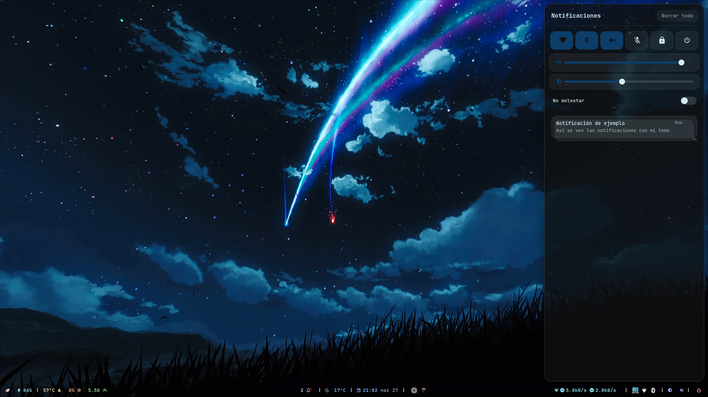 |
| [**Rofi**](stow/rofi)<br>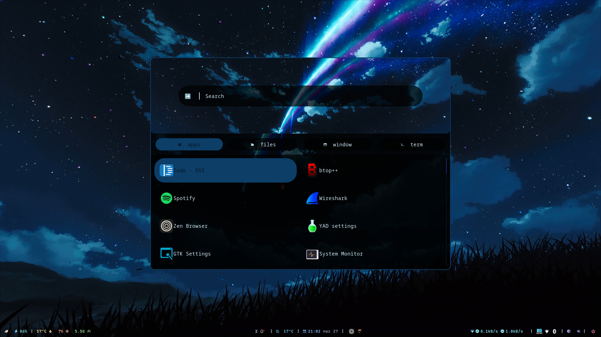 | [**wlogout**](stow/wlogout)<br>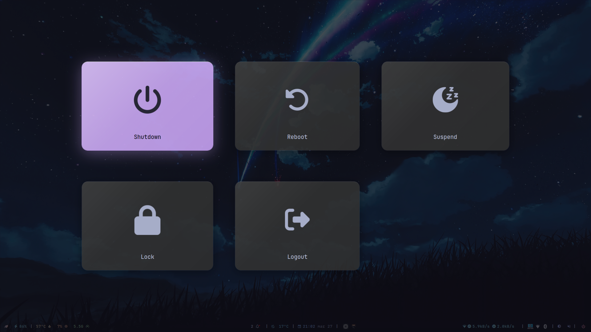 |
| [**Hyprlock**](stow/lock)<br>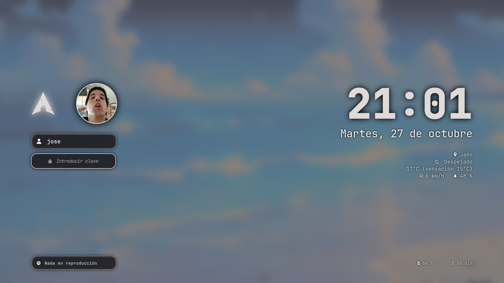 | [**Quickshell (overview)**](stow/quickshell)<br>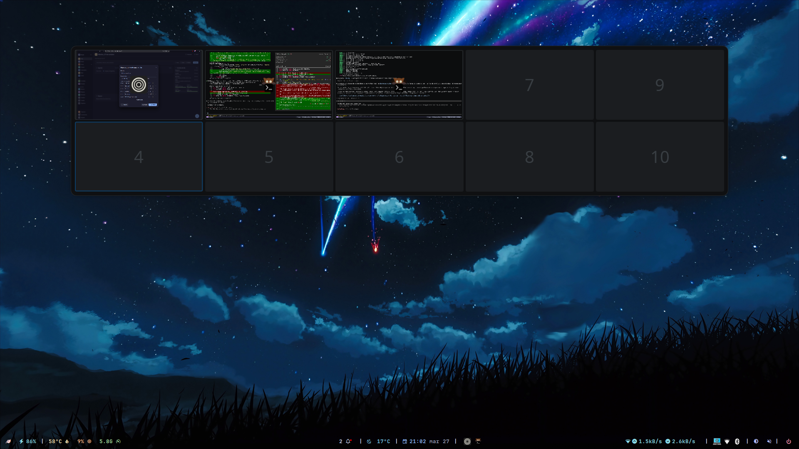 |
| [**Kitty**](stow/kitty)<br>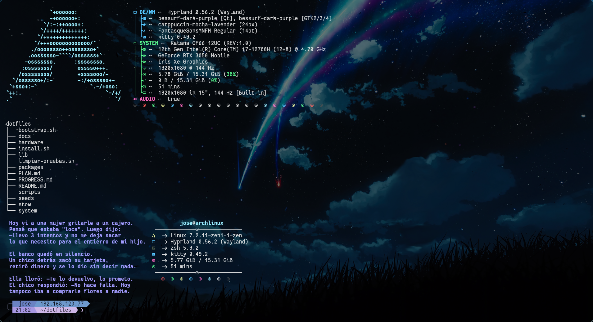 | [**Zsh**](stow/zsh)<br>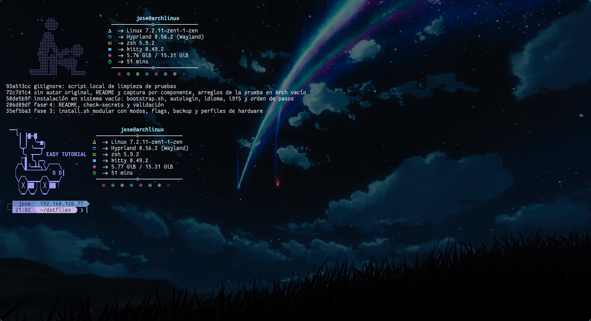 |
| [**Thunar**](seeds/filemanager)<br>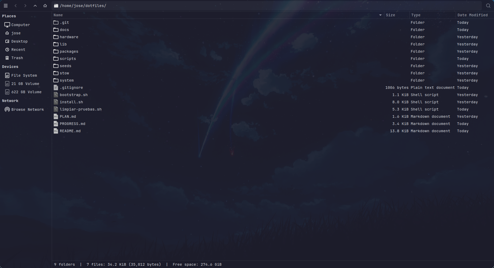 | [**Tema GTK/Qt**](stow/theme)<br>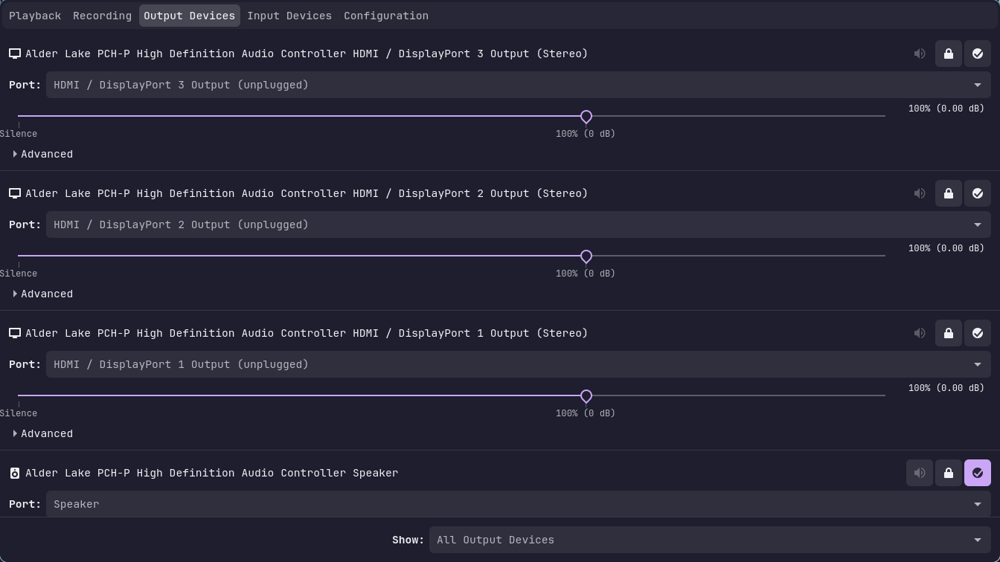 |
| [**Code - OSS**](stow/code-oss)<br>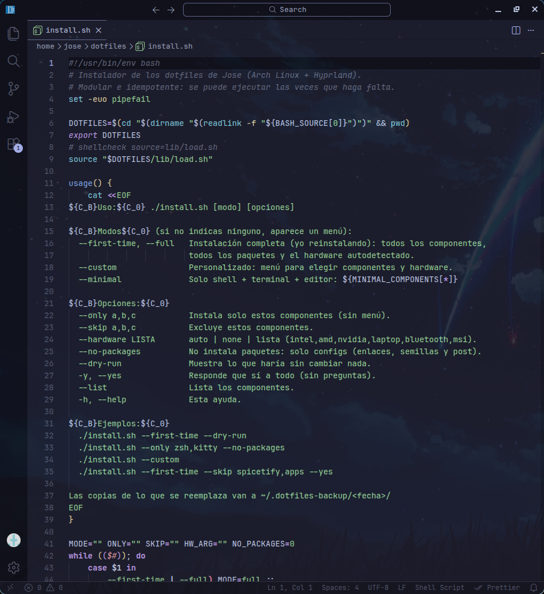 | [**Nano**](stow/nano)<br>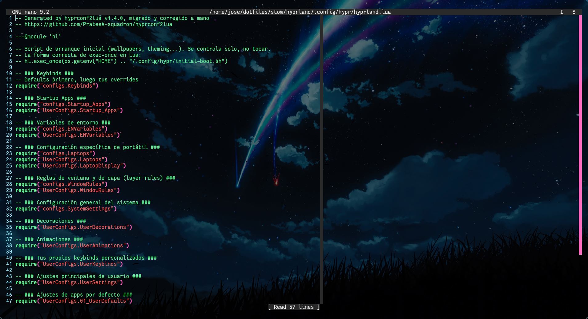 |
| [**btop y CLI**](stow/cli)<br>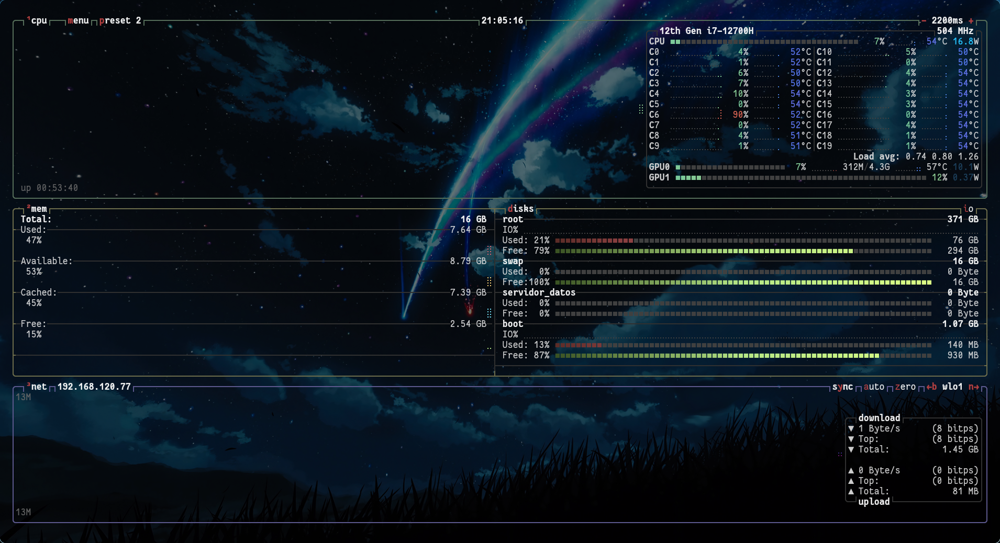 | |

> Las capturas se regeneran con `./scripts/capturas.sh` dentro de Hyprland
> (o `./scripts/capturas.sh kitty rofi` para rehacer solo algunas).

## Requisitos

- Arch Linux (o derivada con `pacman`) y conexión a internet.
- Un usuario normal con `sudo` (**no** ejecutes el instalador como root).
- El instalador pone por su cuenta `base-devel`, `git`, `stow` y `yay` si faltan
  (si ya tienes `paru`, lo usa en su lugar).
- Opcional: `gum` o `fzf` para menús más cómodos (si no, usa menús numerados).

## Instalación en un Arch nuevo (el caso para el que está pensado)

**1. Instala Arch base**, por ejemplo con `archinstall`:
- Perfil mínimo, sin escritorio: Hyprland lo pone el script.
- Un usuario con `sudo` (grupo `wheel`).
- GRUB, y red con NetworkManager.
- Kernels `linux` y `linux-zen`, si los quieres como ahora.

**2. Arranca, entra en la TTY con tu usuario y ejecuta un solo comando:**

```bash
bash <(curl -fsSL https://raw.githubusercontent.com/JoseMValeroPalomares/DotFIles/main/bootstrap.sh) --first-time --yes
```

`bootstrap.sh` instala git, clona el repo en `~/dotfiles` y lanza `install.sh`. Con `--yes`
no pregunta nada: instala todos los paquetes, aplica todas las configs, detecta el hardware y
lo configura. También activa los servicios, el autologin en tty1, el idioma y la zona horaria.
Quita `--yes` si prefieres confirmar cada paso con sudo.

Si prefieres hacerlo a mano:

```bash
sudo pacman -Syu --needed git
git clone https://github.com/JoseMValeroPalomares/DotFIles.git ~/dotfiles
cd ~/dotfiles
./install.sh --first-time --dry-run   # mira qué haría
./install.sh --first-time --yes       # y hazlo
```

**3. Reinicia.** El autologin en tty1 y `.zprofile` arrancan Hyprland con uwsm.

**4. Lo que queda a mano** (no se puede o no debe ir en un repo):
- Copia tus fondos a `~/Pictures/wallpapers` desde tu drive y elige uno con el selector de
  fondos. Wallust regenera los colores de todo.
- Abre Spotify una vez, ciérralo y ejecuta `~/dotfiles/scripts/post/spicetify.sh`.
  Spicetify necesita el archivo de preferencias que Spotify crea al abrirse por primera vez.
- Restaura lo privado: claves `~/.ssh` y `~/.gnupg`, tus tokens y el perfil del navegador.
- Proyectos que no están en el repo: `~/Projects/panel-maestro` (los servicios de usuario
  se activan solos en la siguiente ejecución si su carpeta existe), `~/cronometro`…

> El repo debe quedarse en `~/dotfiles`: los enlaces de stow apuntan ahí.
> Volver a ejecutar `install.sh` es seguro: lo que ya está al día no se toca.

## Modos

| Modo | Qué hace |
|---|---|
| `--first-time` (o `--full`) | **Instalación completa**, pensada para mí reinstalando: todos los paquetes, todas las configs, Oh My Zsh y plugins, Spicetify, extensiones de Code, servicios y el hardware **autodetectado** (en mi portátil: intel, nvidia, laptop, bluetooth, msi). |
| `--custom` | **Personalizado**: menú para elegir componentes y después hardware (lo autodetectado sale marcado). Pregunta si instalar paquetes o solo las configs. |
| `--minimal` | Solo shell + terminal + editor: `zsh`, `kitty`, `nano`. |
| _(sin modo)_ | Muestra un menú para elegir uno de los anteriores. |

## Opciones

| Flag | Efecto |
|---|---|
| `--only a,b` | Solo esos componentes (sin menú). |
| `--skip a,b` | Excluye componentes de cualquier modo. |
| `--hardware X` | `auto`, `none` o lista: `intel,amd,nvidia,laptop,bluetooth,msi`. |
| `--no-packages` | No instala paquetes: solo enlaces, semillas y pasos post. |
| `--dry-run` | Simulación: enseña cada comando, backup y enlace sin cambiar nada. |
| `-y`, `--yes` | Responde «sí» a todo, incluido `chsh` y los ajustes de `/etc`. |
| `--list` | Lista los componentes. |
| `-h`, `--help` | Ayuda. |

Ejemplos:

```bash
./install.sh --custom
./install.sh --only zsh,kitty,nano --no-packages
./install.sh --first-time --skip spicetify,apps,dev --yes
./install.sh --only spicetify            # p. ej. tras una actualización de Spotify
```

Todos los pasos con `sudo` se anuncian antes con `[sudo]`, y al final sale un resumen
con lo instalado, lo omitido y los errores. Si un componente falla, se anota y se sigue con el resto.

## Componentes

| Componente | Qué incluye | Paquetes clave | Depende de (recomendado) |
|---|---|---|---|
| `base` | Kernels, GRUB, red, utilidades; activa NetworkManager | base, linux, linux-zen, networkmanager | — |
| `fonts` | Nerd Fonts, Noto, JetBrains, Victor Mono | ttf-*, otf-font-awesome | — |
| `theme` | GTK 3/4, Qt5/6ct, Kvantum Catppuccin, iconos bessurf, temas Flat-Remix GTK, cursores | catppuccin-gtk/cursors (AUR), kvantum, flat-remix, bibata | — |
| `multimedia` | PipeWire y reproductores | pipewire, wireplumber, mpv, loupe | — |
| `hyprland` | `~/.config/hypr` completo (Lua, scripts, UserConfigs, animaciones) | hyprland, uwsm, awww, cliphist, nwg-* | waybar, swaync, rofi, lock, wallust, kitty, filemanager |
| `lock` | `hyprlock.conf`, `hypridle.conf`, scripts de bloqueo y foto de perfil | hyprlock, hypridle | hyprland, wallust |
| `waybar` | Configs, estilos, módulos y `clima.py` (Open-Meteo) | waybar, playerctl, pavucontrol | hyprland, swaync |
| `swaync` | Notificaciones, iconos generados con wallust y avisos del sistema (`notifyd`) | swaync, python-gobject, librsvg, pacman-contrib, upower, udisks2 | — |
| `rofi` | Lanzador, menús (calc, emoji, portapapeles, fondos) y temas | rofi | wallust |
| `wlogout` | Menú de energía parcheado (se compila al instalar) | gtk3, gtk-layer-shell, wlogout (AUR) | hyprland, lock |
| `wallust` | Config y plantillas de colores | wallust (AUR) | — |
| `quickshell` | Overview de escritorios (Super+A) | quickshell | hyprland, wallust |
| `ags` | Widgets de AGS | aylurs-gtk-shell-git (AUR) | — |
| `filemanager` | **Thunar**: atajos, acciones personalizadas, preferencias | thunar + plugins, tumbler, gvfs | — |
| `kitty` | `kitty.conf` y temas | kitty | fonts |
| `zsh` | `.zshrc`, `.zshenv`, `.zprofile`, `.tmux.conf`, temas propios; clona OMZ y plugins | zsh, tmux, lsd, bat, fzf, zoxide, fnm | — |
| `nano` | `nanorc` + resaltado de scopatz/nanorc | nano | — |
| `code-oss` | `settings.json`, `keybindings.json`, `tasks.json`, snippets, tema local de wallust y 16 extensiones | code | wallust |
| `spicetify` | Spotify + Spicetify (StarryNight, marketplace) y `.desktop` con Wayland | spotify (AUR) | — |
| `bin` | `~/.local/bin/brillo` y `screenshot-ocr` | ddcutil, tesseract | — |
| `cli` | btop, fastfetch, cava, ghostty, wezterm, peaclock, swappy, yad, clangd… | btop, fastfetch | — |
| `apps` | zen-browser, kicad, wireshark, qalculate, mousepad | — | — |
| `dev` | Compiladores, Python, Rust, Java, Bun, Arduino (grupos uucp/lock para el puerto serie) | clang, cmake, rust, bun… | — |
| `net` | nmap, mtr, arp-scan, lftp, wol… | — | — |
| `xdg` | `mimeapps.list`, `user-dirs.dirs` | — | — |
| `git` | `~/.gitconfig` | git | — |
| `wallpapers` | Crea `~/Pictures/wallpapers` (los fondos **no** van en el repo) | — | — |
| `systemd-user` | `panel-maestro` y `panel-estudio-server` (solo si existe su proyecto) | — | — |
| `system` | `/etc`: opciones de pacman, zram, sysctl, reflector, Wi-Fi ES, idioma (en_US + es_ES), teclado us, zona Europe/Madrid, autologin en tty1, `/usr/local/bin` | — | — |

Perfiles de hardware (`hardware/`):

| Perfil | Qué hace |
|---|---|
| `intel` | intel-ucode, VA-API (intel-media-driver, libva-intel-driver), `i915` en el initramfs |
| `amd` | amd-ucode, mesa, vulkan-radeon |
| `nvidia` | nvidia-open-dkms, PRIME, CUDA, nouveau en lista negra; con Intel, `envycontrol -s hybrid --rtd3 2` |
| `laptop` | power-profiles-daemon, thermald, brightnessctl |
| `bluetooth` | bluez, blueman y servicio activo |
| `msi` | msi-ec-dkms, MControlCenter, regla udev y (preguntando) `acpi_enforce_resources=lax` en GRUB |

### Independencia entre componentes

Ningún componente falla si falta otro; como mucho, algo deja de responder:

- Sin `spicetify`, Waybar sigue funcionando: el módulo multimedia usa `playerctl` con cualquier reproductor.
- Sin `lock`, Ctrl+Alt+L no hace nada. Sin `wlogout`, Super+L tampoco.
- Waybar llama a scripts de `~/.config/hypr/scripts`: sin `hyprland`, esos módulos no responden.
- Los módulos de agenda y captura rápida usan `~/Projects/panel-maestro`. Si no existe, no hacen nada.
- Sin `wallust`, las configs usan los colores guardados en `seeds/` (los del último fondo).
- Si faltan los wallpapers, los scripts de fondos avisan de que la carpeta está vacía.

### Atajos de bloqueo

- **Ctrl+Alt+L**: `LockScreen.sh` → `loginctl lock-session` → `hypridle` → `hyprlock`.
- **Super+L**: `wlogout`, que incluye el botón «Bloquear».
- `hypridle`: bloquea a los 4,5 minutos y apaga la pantalla a los 5,5. No suspende.

## Cómo funciona por dentro

```
dotfiles/
├── bootstrap.sh          # arranque en un sistema vacío: git + clone + install.sh
├── install.sh            # punto de entrada
├── lib/                  # common (log, run, confirm), pkg (pacman/AUR), backup, stow, ui, hardware, components
├── packages/             # <componente>.pacman.txt / .aur.txt, hw-*.txt, code-extensions.txt
├── stow/<componente>/    # se ENLAZA en $HOME (replica su estructura)
├── seeds/<componente>/   # se COPIA a $HOME solo si no existe
├── scripts/post/         # pasos extra por componente (se pueden lanzar solos)
├── scripts/check-secrets.sh
├── hardware/             # intel.sh, amd.sh, nvidia.sh, laptop.sh, bluetooth.sh, msi.sh
└── system/files/         # archivos de /etc y /usr/local/bin
```

- **`stow/`** se enlaza con `stow --no-folding`: crea un enlace por archivo, no por carpeta.
  Así lo que las apps generan en tiempo de ejecución se queda en `~` y no ensucia el repo.
- **`seeds/`** guarda los archivos que las apps reescriben solas: colores de wallust, el
  `config`/`style.css` activo de Waybar, Thunar, qt5ct, nwg-look, monitores, iconos… Se copian
  una vez y no se vuelven a tocar.
- Si una app sustituye un enlace por un archivo normal (por ejemplo, con `sed -i`), recupera el cambio en el repo con:
  ```bash
  cd ~/dotfiles && stow --no-folding --adopt -d stow -t ~ <componente> && git diff
  ```

### Qué no está en el repo (a propósito)

- Wallpapers (~2 GB): cópialos a `~/Pictures/wallpapers` desde tu drive.
- Credenciales de Spotify (`prefs`), historiales, cachés, cookies, `.ssh`, `.gnupg`, tokens.
- `globalStorage`, `workspaceStorage` y `History` de Code - OSS.
- Plugins de Oh My Zsh, temas de Spicetify y `~/.nano`: se clonan al instalar.
- Iconos Flat-Remix y cursores Bibata: se instalan desde AUR.
- Dependencias implícitas (gst-*, lib*, tk…): las arrastran los paquetes de las listas.

## Añadir un componente nuevo

1. Copia la config replicando la ruta de `$HOME`: `stow/<nombre>/.config/<app>/...`.
   Si la app reescribe sus archivos, ponlos en `seeds/<nombre>/...`.
2. Paquetes: `packages/<nombre>.pacman.txt` y/o `packages/<nombre>.aur.txt` (uno por línea).
3. Regístralo en `lib/components.sh`: añádelo a `COMPONENTS` (en orden) y a `COMP_DESC`.
   Si conviene, añade también `COMP_RECOMMENDS`.
4. Opcional: crea `scripts/post/<nombre>.sh` con una función `post_<nombre>` (los guiones pasan
   a `_`). Copia el bloque final de cualquier otro post-instalador para poder lanzarlo solo.
5. Prueba: `./install.sh --only <nombre> --dry-run` y `./scripts/check-secrets.sh`.

## Restaurar el backup

Cada ejecución mueve lo que reemplaza a `~/.dotfiles-backup/<fecha>/` (`home/` para tu
carpeta personal y `system/` para `/etc`). Nunca se borra nada. Para volver atrás:

```bash
cd ~/dotfiles
stow --no-folding -d stow -t ~ -D <componente>              # quita los enlaces
rsync -a ~/.dotfiles-backup/<fecha>/home/ ~/                 # devuelve tus archivos
sudo rsync -a ~/.dotfiles-backup/<fecha>/system/ /           # solo si tocó /etc
```

## Spicetify y las actualizaciones de Spotify

Spicetify parchea `/opt/spotify`, así que tu usuario tiene que poder escribir ahí.
Cada actualización de Spotify devuelve los archivos a root y borra el parche. Para arreglarlo:

```bash
./scripts/post/spicetify.sh
```

Ese script comprueba los permisos y pregunta antes de hacer `chown`. Después prueba, por orden,
`backup apply`, `restore backup apply` y, si el backup está roto, `clear` + `backup apply`.

## Seguridad

Antes de cada `git push`:

```bash
./scripts/check-secrets.sh
```

Revisa nombres prohibidos y patrones de tokens o claves. Si tienes `gitleaks` o `trufflehog`,
los usa también. Sale con error si encuentra algo.
